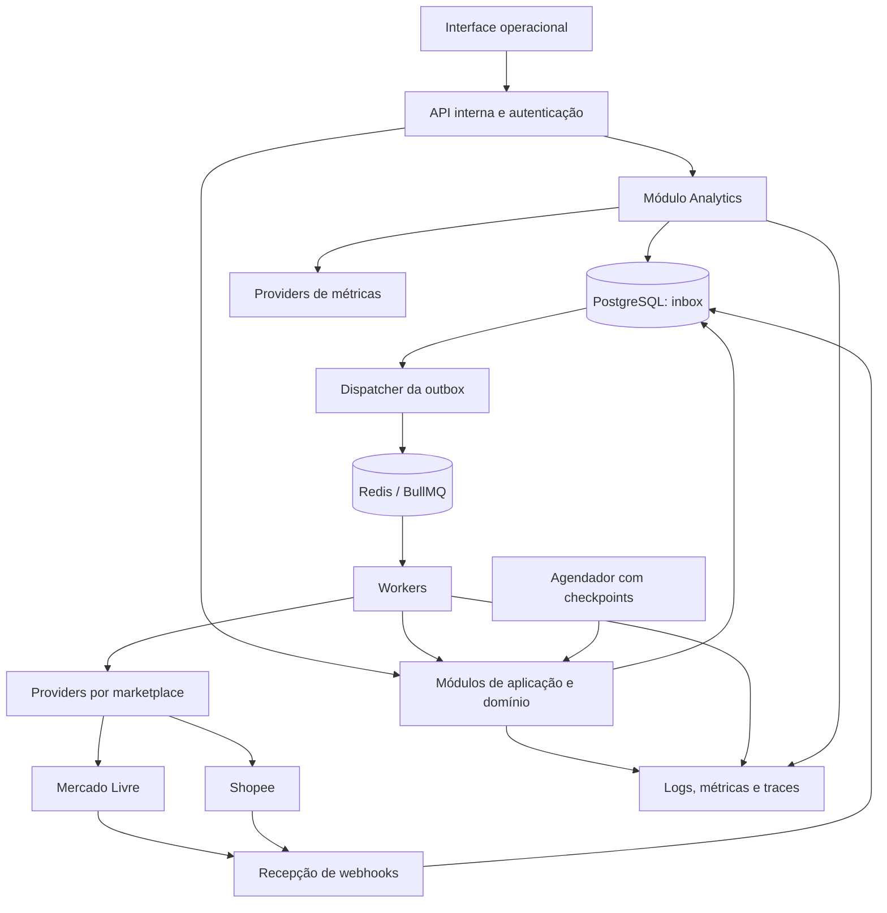
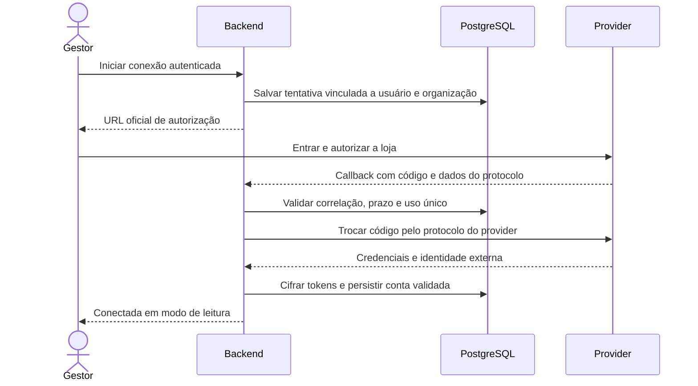
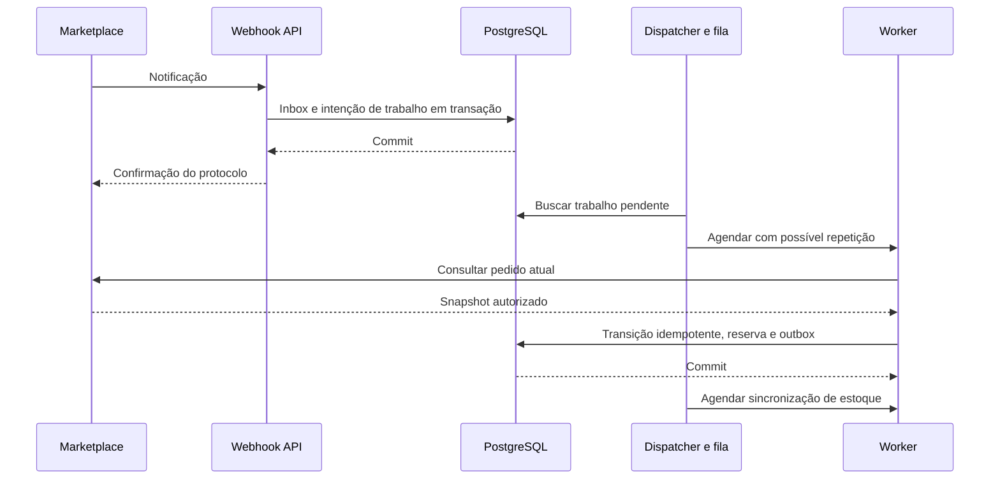
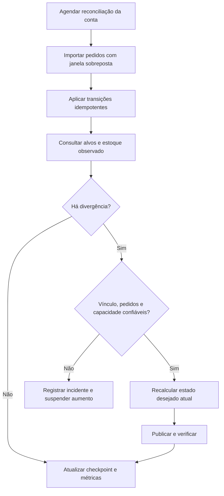
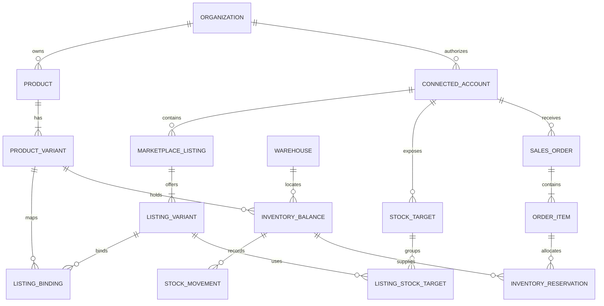

# Arquitetura — Hub de estoque e integração com marketplaces

**Estado técnico posterior (23/10/2026):** React/Vite + NestJS; Docker local e híbrido com Neon development; Preview Vercel protegido com Function de diagnóstico. Production Docker separada aprovada na [SPEC-006](docs/specs/SPEC-006-production-docker.md), backend ativo e configuração Vercel preparada/desligada até promoção explícita. A [matriz atual](docs/operations/environment-configuration.md) e o [guia produtivo](docs/operations/production-docker.md) substituem os trechos históricos abaixo sobre infraestrutura ainda não escolhida. O domínio de negócio continua uma proposta sem funcionalidades implementadas.

**Versão:** 0.2 — proposta consolidada com decisões do piloto  
**Data:** 23/10/2026  
**Produto e escopo:** [prd.md](prd.md)  
**Primeiros providers:** Mercado Livre e Shopee, foco Brasil

**Decisão atual (23/10/2026):** o usuário escolheu **React + Vite + NestJS com TypeScript**, substituindo SvelteKit para priorizar tecnologias familiares em um produto potencialmente produtivo. `compose.yaml` executa web, API, worker, PostgreSQL 17 e Redis 7.4. Consulte [SPEC-001](docs/specs/SPEC-001-react-vite.md) e [operação local](docs/operations/local-development.md). Isto efetiva somente a base técnica: regras de domínio, ORM, filas de negócio e contratos externos continuam pendentes. API e worker compartilham backend; a SPA não acessa o banco diretamente. O proxy `/api` do Vite é exclusivo de desenvolvimento; o roteamento e servidor estático de produção ainda serão definidos.

## 1. Objetivo e limites

**Atualização de infraestrutura (23/10/2026):** adotado o desenho híbrido da [SPEC-003](docs/specs/SPEC-003-hybrid-development.md): frontend estático Vercel, API/worker Docker e Neon remoto somente development, com Redis local. Cloud Functions não têm responsabilidade definida nesta etapa. O usuário criará recursos manualmente conforme [guia](docs/operations/hybrid-development.md); publicação, autenticação/túnel e operação produtiva continuam pendentes. O Compose padrão permanece completamente local.

Implementar um núcleo de estoque consistente e auditável, integrações assíncronas para vendas e disponibilidade, e relatórios de vendas/público baseados somente em dados oficiais disponibilizados pelos canais autorizados. O piloto atende uma empresa/loja, poucos usuários e um depósito próprio. PostgreSQL mantém fatos de estoque, pedidos, proveniência analítica e trabalho durável. Filas desacoplam chamadas externas; providers traduzem as particularidades dos marketplaces.

O sistema será a fonte de verdade **do estoque próprio gerenciado**, das reservas internas e do mapeamento de SKUs. Os canais continuam sendo a autoridade sobre seus pedidos e estados externos. Inventário em fulfillment externo não passa a ser estoque próprio por estar visível via API.

Não existe transação distribuída entre PostgreSQL, Mercado Livre e Shopee. A arquitetura oferece atomicidade local e convergência externa, com entrega de trabalho pelo menos uma vez e efeitos locais idempotentes. Não promete processamento global exatamente uma vez nem eliminação absoluta de overselling.

O escopo de negócio consolidado no PRD é uma única empresa/loja e um estoque próprio compartilhado entre Mercado Livre e Shopee. O saldo inicial é inserido antes de habilitar sincronização e não há importação de vendas anteriores. Os contratos de eventos, permissões e indicadores disponíveis continuam dependendo de validação por conta; não há aprovação de APIs ou volume real presumidos.

## 2. Abordagem recomendada e alternativas

Recomenda-se **monólito modular com processos separados de API e workers**, compartilhando o mesmo código de domínio e banco. Isso mantém transações simples e permite escalar processamento externo sem distribuir o domínio prematuramente.

| Abordagem | Vantagem | Custo / motivo da escolha |
| --- | --- | --- |
| Monólito modular + workers | Transações locais, poucos componentes e limites de módulos claros | Escolha inicial; exige disciplina entre módulos |
| Aplicação única com chamadas externas síncronas | Menor estrutura inicial | Não atende bem retries, latência, quotas e recuperação |
| Microserviços por domínio/canal | Escala e implantação independentes | Complexidade de consistência e operação não justificada no MVP |

API e worker são executáveis distintos, não serviços de domínio independentes. Não adotar event sourcing completo: movimentos imutáveis e saldos transacionais são suficientes. Redis não é o livro de estoque.

## 3. Visão dos componentes



PostgreSQL contém inbox, outbox, tarefas lógicas, checkpoints de pedidos/métricas e snapshots analíticos com proveniência. O dispatcher varre pendências e as envia ao BullMQ. Um scanner de recuperação detecta tarefas não concluídas e permite reconstruir a fila caso Redis seja perdido. O agendador também é idempotente e não depende de um único processo vivo.

## 4. Domínio: SKUs, variantes, listings e alvos de estoque

### 4.1 Identidades

- `Product`: agrupamento comercial.
- `ProductVariant`: unidade vendável interna, com ID imutável e SKU único por organização. Produto simples tem uma variante padrão.
- `ConnectedAccount`: organização + provider + ambiente + identidade externa da loja/vendedor. No MVP, representar somente as contas da operação piloto; permitir várias no modelo não obriga expor essa capacidade no produto inicial.
- `MarketplaceListing`: anúncio externo pertencente a uma conta.
- `ListingVariant`: opção vendável externa; usa uma chave canônica de variante simples quando não há variações.
- `ListingBinding`: vínculo explícito entre variante externa e interna, com validação e histórico.
- `StockTarget`: recurso externo efetivamente atualizado. Pode ser anúncio, modelo, User Product ou combinação com localização.

Um SKU interno pode atender vários anúncios e canais. Não usar título, GTIN ou SKU textual externo como chave primária de integração; eles podem faltar ou se repetir. IDs externos são armazenados como texto para evitar perda de precisão.

Anúncio e alvo de estoque não são necessariamente a mesma coisa. Vários listings podem compartilhar um User Product ou outro recurso de inventário. Manter uma relação entre variantes externas e alvos, deduplicar pelo recurso real e impedir que o mesmo alvo seja associado a SKUs internos incompatíveis. Um alvo compartilhado recebe uma operação coordenada, sem somar quantidades repetidas por anúncio.

### 4.2 Saldos e invariantes

Para cada variante e depósito próprio:

```text
H = físico registrado
R = quantidade reservada ainda não consumida
D = demanda conhecida ainda sem alocação física
B = margem de segurança para venda
A = max(0, H - R - D - B)
```

As quantidades são inteiras no MVP. `H >= 0`, `R >= 0`, `R <= H`, `D >= 0`, `B >= 0`. Uma falta comercial não é representada por saldo físico negativo. Reservas e demanda descoberta devem explicar todas as quantidades abertas dos pedidos elegíveis.

A margem limita novas vendas, não impede alocar um pedido externo já aceito sobre físico ainda livre. Uma entrada deve priorizar a resolução das demandas descobertas conforme política aprovada antes de ampliar a oferta externa. Ajuste de contagem que torne `H < R` exige realocar parte das reservas para demanda descoberta na mesma transação e abrir incidente; a prioridade de realocação precisa de validação operacional.

Pedidos com falta podem ter alocação parcial por item, porém não aparecem como prontos para atendimento integral. Reserva parcial não autoriza expedição parcial automática.

### 4.3 Transições propostas

| Evento normalizado | Efeito local |
| --- | --- |
| Pedido com compromisso de venda | Criar reserva até o físico livre e registrar eventual falta |
| Pagamento confirmado | Atualizar estado; preservar a reserva já criada |
| Quantidade aumentada | Reservar somente a diferença, com falta explícita se necessário |
| Quantidade reduzida/cancelamento antes da expedição | Liberar reserva e demanda apenas na quantidade restante elegível |
| Expedição confirmada | Consumir reserva e reduzir físico atomicamente |
| Cancelamento/reembolso após expedição | Não aumentar físico automaticamente |
| Devolução recebida e conferida | Entrada própria auditada, quando esse fluxo for habilitado |

Os nomes externos de status não entram diretamente no domínio. Cada adapter terá tabela de transições e evidências: quando um pedido compromete estoque, quando a logística confirma expedição e quais mudanças parciais são possíveis. Status desconhecido vira pendência, sem liberar unidades por suposição.

Não expirar reservas de marketplace apenas por tempo decorrido. Consultar o estado atual; ausência de resposta não prova cancelamento. Se a primeira visão de um pedido já for expedida, aplicar uma transição de captura e consumo com chave única, sujeita às regras de baseline e histórico.

### 4.4 Autoridade e edição externa

Ajustes do físico entram pelo núcleo, nunca por importação automática da quantidade anunciada. Pedido importado é um novo fato de demanda, não um ajuste do estoque remoto. Alteração manual no marketplace produz divergência e é tratada de acordo com a política de autoridade aprovada.

Por padrão proposto, não resolver divergência aumentando cegamente o remoto. Primeiro importar pedidos recentes e validar alvos e modelo logístico. Uma conta desconectada pode continuar vendendo externamente; a interface deve mostrar esse risco e bloquear reposições automáticas relacionadas até recuperar a visão da demanda.

## 5. Consistência transacional, concorrência e reservas

O módulo Inventory é o único autorizado a alterar saldos, reservas e movimentos. Outros módulos chamam seus casos de uso.

Transação de processamento de pedido:

1. Identificar organização, conta, pedido e versão externa quando disponível.
2. Obter lock do pedido e dos saldos necessários em ordem estável por variante/depósito, evitando deadlocks.
3. Verificar transição já aplicada e consistência do snapshot; calcular diferenças por item.
4. Alocar/liberar/consumir quantidades sob lock de linha, com constraints no banco.
5. Atualizar pedido e reservas; inserir movimentos, registros de idempotência e outbox.
6. Commit; somente depois comunicar efeitos externos.

`SELECT ... FOR UPDATE` e constraints são a base recomendada. Versão otimista serve para ajustes manuais concorrentes, retornando conflito em vez de sobrescrever saldo alterado. Repetir transações que sofrerem deadlock com limite curto. Não manter locks PostgreSQL abertos durante chamadas HTTP.

Exemplo de última unidade: `H=1, R=0`. A primeira transação reserva 1. A segunda encontra `R=1`, não reserva novamente e registra `D=1`. Publica disponibilidade zero. Ambas as vendas podem já ter sido aceitas pelos canais; o bloqueio local não desfaz a venda externa nem cancela automaticamente pedidos.

### 5.1 Compartilhamento entre canais e risco de reposição

No modo compartilhado, cada alvo pode receber `A`, limitado por teto comercial opcional. Isso **não** transforma a soma das ofertas remotas em estoque exclusivo. Dois canais podem vender a última unidade antes de qualquer evento chegar.

Há outra corrida: o canal vende e reduz o próprio estoque, mas o sistema ainda desconhece o pedido; uma publicação com saldo antigo pode repor a unidade vendida. Medidas propostas:

- Importar pedidos recentes antes de ativação, reconciliação corretiva e aumentos de estoque.
- Suspender aumentos com cursor atrasado, erro de pedidos, vínculo desconhecido ou chamada anterior de resultado incerto.
- Usar margem de segurança e alertar atraso de eventos/polling.
- Comparar saldo observado e interpretar quedas inesperadas como possível venda pendente.
- Validar semântica de atualização e mecanismos condicionais específicos de cada provider.

Mesmo uma consulta imediatamente anterior à escrita não elimina a corrida. Caso o negócio exija proteção mais forte, especificar cotas exclusivas por canal cuja soma caiba no disponível, com transferência controlada de cotas e sem reposição enquanto houver vendas desconhecidas. Essa política altera a disponibilidade comercial e precisa de validação; não está habilitada silenciosamente no MVP.

## 6. Contas conectadas, OAuth e credenciais

### 6.1 Fluxo de autorização

Mercado Livre documenta OAuth 2.0 com código de autorização, `state` e suporte a PKCE conforme configuração. O backend troca o código e mantém as credenciais; o vendedor não informa sua senha ao hub. Fonte: [Autenticação e autorização](https://developers.mercadolivre.com.br/pt_br/autenticacao-e-autorizacao).

Shopee possui fluxo próprio de autorização e tokens de loja, além de chamadas com `partner_id`, timestamp e assinatura HMAC-SHA256 conforme o tipo de API. Não tratar seu protocolo como idêntico ao OAuth do Mercado Livre. Fontes: [API calls](https://open.shopee.com/developer-guide/16) e [Authorization and Authentication](https://open.shopee.com/developer-guide/20).



Para Mercado Livre, usar `state` imprevisível, curto, de uso único e vinculado à sessão e organização, com PKCE S256 quando habilitado. Para Shopee, validar o mecanismo de correlação realmente aceito pelo fluxo escolhido: usar sessão autenticada e tentativa de conexão vinculada no servidor; se não houver correlação segura suficiente no retorno, exigir confirmação autenticada da loja antes de associá-la à organização. Nunca confiar em `organization_id` ou `shop_id` recebido do navegador como prova de propriedade.

Callback e redirect URI devem ser explicitamente permitidos. Código não pode ser reutilizado nem registrado em logs. Depois da troca, consultar/verificar a identidade autorizada e suas capacidades antes de habilitar importação ou escrita.

### 6.2 Armazenamento e renovação

- Client secrets e partner keys ficam em gerenciador de segredos; tokens de cada conta ficam cifrados no banco, com versão da chave.
- Usar cifragem autenticada com nonce único e chave externa ao banco; restrição de acesso também se aplica a backups.
- Armazenar `expires_at`, vencimento da autorização quando disponível, scopes/capabilities, ambiente e versão da credencial.
- Renovar conforme prazo retornado e política do provider, sem fixar a mesma duração para todos.
- Coordenar um refresh por conta usando lease durável e atualização condicional de versão. Não segurar transação aberta durante HTTP.
- Persistir o novo par access/refresh atomicamente; Mercado Livre documenta rotação de refresh token de uso único. Evitar refresh concorrente que perca a credencial mais recente. Fonte: [Mercado Livre — refresh token](https://developers.mercadolivre.com.br/pt_br/autenticacao-e-autorizacao).
- Se houver timeout após refresh e o token antigo puder ter sido consumido, usar recuperação documentada ou exigir reautorização. Não repetir indefinidamente.
- Um 401 pode provocar uma renovação coordenada e uma repetição; revogação, `invalid_grant` e falta de permissão viram estados acionáveis.

Estados sugeridos: `READ_ONLY`, `ACTIVE`, `DEGRADED`, `REAUTH_REQUIRED`, `PAUSED`, `DISCONNECTED`. Autorização válida não significa escrita habilitada. Desconectar cancela novas chamadas, invalida acesso local aos segredos e segue a política de revogação disponível no provider.

## 7. Webhooks, inbox, outbox e filas

### 7.1 Recepção durável

1. Endpoint específico por provider e ambiente recebe corpo bruto e metadados permitidos.
2. Validar método, tamanho, formato, destinatário, tópico e autenticidade conforme contrato do canal.
3. Verificar assinatura quando documentada e disponível. Não inventar um header universal compartilhado pelos providers.
4. Resolver conta por identidade externa verificada, não por organização arbitrária enviada na URL.
5. Gravar inbox e intenção de processamento na mesma transação; duplicata válida já persistida pode receber confirmação.
6. Responder no formato e prazo exigidos. O processamento de negócio ocorre depois.

Se PostgreSQL falhar, não responder sucesso como se o evento estivesse durável. Redis indisponível não exige perda do webhook: a inbox persiste até o dispatcher recuperar. O path de recepção deve ser curto; meta interna sugerida p95 inferior a 300 ms, a validar contra o prazo do canal.

No Mercado Livre, notificações indicam recursos a consultar; o worker busca a representação autorizada antes de aplicar mudanças. Não presumir que a notificação contenha o pedido inteiro. Fonte: [Notificações](https://developers.mercadolivre.com.br/pt_br/produto-receba-notificacoes).

Sem autenticação verificável no protocolo de um tópico, tratar mensagem como gatilho não confiável para consulta de recurso autorizado. Não aplicar quantidades financeiras ou de estoque diretamente do payload. Restringir host e paths de consulta para impedir SSRF; nunca executar GET de uma URL arbitrária recebida.

### 7.2 Idempotência em camadas

| Camada | Chave / mecanismo |
| --- | --- |
| Notificação | Provider + ambiente + conta + event ID, quando houver; fallback documentado por tópico |
| Pedido | Conta + order ID; linhas identificadas por chave estável externa |
| Efeito de domínio | Pedido/linha + tipo de transição + revisão ou quantidades acumuladas já aplicadas |
| Comando interno | Organização + operação + `Idempotency-Key`, com hash do corpo |
| Outbox/tarefa | Evento de domínio + consumidor; execução recuperável |
| Publicação | Stock target + versão desejada; tentativa e confirmação separadas |

Sem event ID confiável, não deduplicar para sempre por `resource`: esse mesmo pedido terá novas alterações. Hash do payload pode reduzir duplicatas por janela curta, mas a garantia principal continua no efeito de domínio. Não confiar no job ID do BullMQ como única barreira: jobs podem ser removidos e recriados.

### 7.3 Entrega e recuperação

Outbox contém eventos como `StockAvailabilityChanged`, `OrderAllocationChanged` e `AccountNeedsReauthorization`. Dispatcher faz claim com lease, cria/atualiza tarefas duráveis e agenda trabalho. Crash após enqueue e antes do checkpoint pode duplicar execução; consumidores devem tolerar isso.

Tarefas têm estado `PENDING`, `RUNNING`, `RETRY_AT`, `SUCCEEDED`, `DEAD` ou `CANCELLED`, com lease, tentativa e versão. Um scanner recupera leases vencidos e reenvia tarefas incompletas ao Redis. Outbox não é descartada antes da política de retenção e confirmação dos consumidores; trabalho terminal continua rastreável.

Filas lógicas sugeridas: `ingest-events`, `refresh-orders`, `sync-stock`, `refresh-credentials` e `reconcile`. Separar filas só quando prioridade ou isolamento de carga justificarem. Jobs contêm IDs, não tokens nem dados pessoais completos.



## 8. Workers, ordenação e publicação de estoque

Controlar concorrência por conta e orçamento de API, mas serializar operações que disputem o mesmo recurso externo. A chave de serialização deve corresponder ao agregado exigido pelo provider: stock target, User Product ou item inteiro quando a atualização envia o conjunto de modelos.

Fluxo de publicação:

1. Claim durável do alvo com lease e versão; verificar conta, ambiente, modo de escrita, vínculo e capacidade.
2. Ler a disponibilidade atual do PostgreSQL. O job é um pedido de sincronização, não uma instrução imutável para enviar quantidade antiga.
3. Antes de aumento, verificar frescor de pedidos, ausência de pendências e resultado da tentativa anterior.
4. Persistir tentativa com versão/quantidade; enviar via adapter com timeout.
5. Interpretar erro semântico e resultados parciais, mesmo com HTTP 200.
6. Confirmar quantidade por resposta autoritativa ou leitura posterior conforme consistência do provider; registrar `last_sent`, `last_observed` e respectivos horários.
7. Se a disponibilidade mudou durante a chamada, agendar a versão mais recente. Não marcar uma versão antiga como a atual.

Coalescer rajadas de alterações pelo alvo para evitar publicar cada saldo intermediário. Atrasos de coalescência são pequenos, configuráveis e não devem postergar reduções urgentes indevidamente.

Fencing token protege mudanças locais de um worker cujo lease venceu. Ele não bloqueia uma chamada antiga já recebida pelo marketplace, salvo se a API oferecer precondição equivalente. Em timeout ou perda do worker com chamada potencialmente em andamento, marcar `UNKNOWN`, suspender novas escritas conflitantes, verificar estado remoto e reconciliar antes de retomar. Uma leitura imediata isolada pode não provar conclusão; respeitar janela e mecanismo de confirmação do canal. Se permanecer ambíguo, escalar para recuperação operacional.

Uma venda é reservada assim que o provider indicar o estado de compra definido para aquele canal. O evento externo não adquire lock no checkout de outro marketplace: ele só permite que o sistema reaja após a plataforma aceitar a compra. Portanto, workers devem priorizar ingestão de pedidos e reduções de disponibilidade; locks locais garantem que duas transações recebidas não aloquem as mesmas unidades. Margem de segurança e monitoramento reduzem o risco residual, mas não tornam as duas plataformas atomicamente coordenadas. Cada provider precisa mapear o estado exato de compra e seus eventos de cancelamento/pagamento antes da ativação.

## 9. Reconciliação periódica e onboarding

Webhooks reduzem latência; polling recupera lacunas. Usar paginação, janela sobreposta, cursor por conta/recurso e orçamento compartilhado com workers. Avançar checkpoint somente após persistir a página completa; falhas retomam do último ponto durável. Sobreposição repete dados de propósito e depende de idempotência.

Cadências iniciais propostas, ajustáveis às quotas e aos testes:

| Processo | Cadência sugerida |
| --- | --- |
| Pedidos novos/alterados | A cada 2–5 min por conta |
| Reconsulta de pedidos abertos | A cada 5–15 min, por estado e risco |
| Verificação de alvos ativos | Varredura particionada em até 15 min no perfil piloto |
| Inventário de anúncios, vínculos e capacidades | Diário e sob demanda |
| Verificação de credenciais | Conforme expiração e chamadas, sem refresh desnecessário |

### 9.2 Métricas de vendas e público

Analytics recebe duas classes de dados: (a) pedidos normalizados já importados para os fluxos de estoque; (b) indicadores e relatórios que cada provider disponibilizar oficialmente para a conta, mediante escopos autorizados. A descoberta de métricas acontece na SPEC de viabilidade, não por scraping, acesso ao painel via automação ou inferência sobre comprador.

O MVP deve oferecer unidades vendidas, ticket médio e produto mais vendido por intervalo e marketplace quando a resposta oficial do pedido contiver os campos e estados necessários. Fórmulas e mapeamento de status ficam versionados por provider; valores de canais diferentes não são agregados se moeda ou semântica forem incompatíveis. Dados de público, demografia, busca, visitas ou interesse só entram quando a API/relatório oficial do canal os expuser para aquela conta e finalidade. Um recurso ausente, não autorizado ou sem cobertura produz estado `UNAVAILABLE`/`PARTIAL`, nunca zero nem dado estimado.

Definições mínimas:

- **Unidades vendidas:** soma da quantidade de linhas de pedidos elegíveis no intervalo, conforme status do provider.
- **Ticket médio:** total de pedidos elegíveis dividido pelo número desses pedidos. Não misturar moedas; política de cancelamento, devolução e reembolso deve seguir o status/dado disponível e aparecer na definição da métrica.
- **Produto mais vendido:** variante/SKU com maior número de unidades elegíveis; oferta sem vínculo interno não é atribuída a um produto até resolver o vínculo.
- **Métrica oficial de público/interesse:** preservar nome, definição, dimensões, granularidade, período e origem do provider; não converter uma métrica proprietária em conceito genérico sem equivalência documentada.

O módulo de Analytics deve preferir agregados e não armazenar nome, contato, endereço, documento ou identificador individual de comprador para gerar esses relatórios. Dados pessoais exigidos por operação de pedidos devem permanecer no mínimo necessário, com finalidade, acesso e retenção definidos conforme PRD e revisão de privacidade.

Cadência de consulta de métricas depende da janela de atualização, retenção e quota documentadas por provider. Persistir cursor/watermark, período consultado, hora de coleta e versão da definição; repetir janelas com sobreposição e deduplicar snapshots por provider, conta, métrica, dimensão e período.

Não comparar somente `updated_at` se o provider não garantir sua semântica. Manter watermark, desempate por ID quando possível e rescan de pedidos abertos para capturar cancelamentos tardios fora da janela usual. Pedidos não encontrados em uma consulta não são considerados cancelados.



### 9.1 Baseline e histórico

Antes da primeira escrita: cadastrar e conferir o saldo inicial, ler as ofertas necessárias, resolver vínculos e registrar o instante de ativação. O piloto não importa nem aplica vendas anteriores ao início do serviço. A partir do instante de ativação, novos pedidos e transições são processados pelo fluxo normal. Se a descoberta técnica mostrar pedidos já abertos ou criados durante a configuração, manter escrita pausada até a política de corte e conciliação ser decidida com o usuário.

Registrar os IDs/revisões da configuração e a versão do saldo inicial, não apenas um horário genérico. Exibir prévia do estado desejado e habilitar escrita depois da conferência. Nova associação de SKU em oferta com pedidos abertos exige reconciliação, não simples troca destrutiva do vínculo.

Após restore: manter escritas pausadas, recuperar pedidos posteriores ao backup, reconstruir tarefas e reconciliar antes de reabrir sincronização. Um backup consistente localmente pode estar atrasado em relação a vendas externas.

## 10. Providers e particularidades dos canais

### 10.1 Contrato de integração

O domínio utiliza capacidades e modelos normalizados, sem conhecer endpoints externos. Contrato conceitual sugerido:

```typescript
interface MarketplaceProvider {
  beginAuthorization(input: AuthorizationAttempt): Promise<AuthorizationRedirect>;
  completeAuthorization(input: ProviderCallback): Promise<AuthorizedAccount>;
  refreshCredentials(input: CredentialReference): Promise<CredentialUpdate>;
  discoverCapabilities(account: AccountReference): Promise<Capabilities>;
  listListings(input: ListingPageRequest): Promise<ListingPage>;
  listChangedOrders(input: OrderWindowRequest): Promise<OrderPage>;
  getOrder(input: ExternalOrderReference): Promise<NormalizedOrderSnapshot>;
  listAvailableMetrics(input: MetricDiscoveryRequest): Promise<MetricCapability[]>;
  getMetrics(input: MetricQuery): Promise<MetricPage>;
  readStock(input: StockTargetReference): Promise<ObservedStock>;
  setStock(input: SetStockRequest): Promise<StockWriteResult>;
  parseNotification(input: RawNotification): Promise<NotificationHint>;
}
```

Tipos acima são fronteiras propostas, não SDK pronto. `SetStockRequest` carrega identidade do alvo e quantidade desejada validada. `StockWriteResult` diferencia aceitação, confirmação, falha parcial e resultado incerto. Detalhes de transporte e assinatura permanecem dentro do provider; erros retornam categoria normalizada mais código externo sanitizado.

`Capabilities` deve representar, ao menos: leitura de pedidos, tópicos disponíveis, escrita de estoque, granularidade do alvo, leitura de confirmação, recursos condicionais, localizações, inventário gerenciado externamente e métricas de analytics autorizadas/disponíveis. A descoberta de métricas deve retornar chave, definição, dimensões, unidade, moeda, intervalo consultável, atraso de atualização e permissões exigidas quando documentados. Pode variar por conta/oferta, não apenas por nome do marketplace.

### 10.2 Mercado Livre

Separar identidade de anúncio/variante de User Product e localização de estoque. Selecionar o fluxo a partir das capacidades da conta e do recurso, sem assumir que toda escrita usa `available_quantity` em `/items`.

A documentação oficial de estoque multiorigem orienta usar os recursos de User Products/localizações para contas desse modelo; também distingue inventário de fulfillment. O adapter deve rejeitar modelo não homologado e verificar o resultado efetivo. Fonte: [Gestão de estoque multiorigem / User Products](https://developers.mercadolivre.com.br/pt_br/api-docs-pt-br/gestao-de-estoque-multiorigem-user-products).

Não escolher endpoints somente pela presença de `user_product_id`; validar tipo de estoque, localização e capacidade. Manter endpoints e detalhes de versão na spec do conector, com exemplos sanitizados da conta piloto. O MVP não escreve em fulfillment nem configura automaticamente uma nova malha de depósitos.

### 10.3 Shopee

Usar Open Platform de vendedor, com identidade da loja e variantes/modelos externos. Assinatura de requisição segue a composição exigida para Shop API, Merchant API ou Public API, mantendo relógio sincronizado. Domínio da API e credenciais devem corresponder ao ambiente e região aprovados. Fonte: [API calls](https://open.shopee.com/developer-guide/16).

Persistir a renovação do par de tokens conforme o fluxo de loja escolhido. Fonte: [Authorization and Authentication](https://open.shopee.com/developer-guide/20).

Antes da escrita, homologar o contrato de estoque aplicável à conta: modelo simples versus variantes, localizações quando existentes, limites de lote e erros parciais. Não deduzir o saldo vendável a partir de campos de estoque de semântica não validada.

O conteúdo oficial consultado confirma os mecanismos gerais de chamada/autorização, mas não substitui a validação dos contratos completos de push e atualização de estoque habilitados para o parceiro brasileiro. Esses contratos, permissões e exemplos reais são dependência de SPEC-001/SPEC-010 do PRD, não recursos aqui declarados como já testados.

### 10.4 Expansão

Amazon e Magalu entram como novos providers após descobrir autorização, unidades de estoque, pedidos e limites próprios. Site próprio e PDV podem usar comandos transacionais internos para reservar antes de aceitar uma venda, oferecendo controle mais forte nessa fronteira. PDV offline, kits e estoque em múltiplos depósitos exigem novas specs; não são resolvidos apenas adicionando um adapter.

## 11. Modelo de dados sugerido

O piloto tem uma única empresa. `organization_id` pode identificar essa empresa e proteger os vínculos de dados desde o início, mas o MVP não precisa implementar onboarding multiempresa, cobrança ou operação SaaS. Tabelas de negócio incluem esse identificador, timestamps UTC e IDs internos imutáveis. Relacionamentos sensíveis usam FKs compostas com organização ou validação equivalente no banco. JSONB fica restrito a metadados externos versionados; quantidades e relações críticas têm colunas tipadas.

| Tabela | Campos/conceitos essenciais | Restrições principais |
| --- | --- | --- |
| organizations | nome, estado | Identidade do proprietário dos dados |
| users / memberships | identidade de login, organização, papel | Acesso por vínculo ativo |
| products | nome, estado | Organização obrigatória |
| product_variants | product_id, sku, atributos, active | UNIQUE organização + SKU normalizado |
| warehouses | nome, tipo próprio/externo, active | Um próprio ativo no MVP |
| inventory_balances | variant_id, warehouse_id, on_hand, reserved, shortage, buffer, version | UNIQUE variante + depósito; checks de saldo |
| stock_movements | saldo, deltas, tipo, motivo, referência, autor | Append-only; chave de efeito única |
| connected_accounts | provider, environment, external_account_id, estado, capabilities | UNIQUE provider + ambiente + identidade externa no escopo de propriedade definido |
| account_credentials | account_id, tokens cifrados, expires_at, key_version, version, refresh_lease | Acesso restrito; rotação condicional |
| authorization_attempts | usuário, organização, provider, nonce/hash, prazo, consumed_at | Uso único e expiração |
| marketplace_listings | account_id, external_listing_id, título, estado, logistics_type | UNIQUE conta + ID externo |
| listing_variants | listing_id, external_variant_key, external_sku, metadata | UNIQUE anúncio + variante canônica |
| listing_bindings | listing_variant_id, variant_id, valid_from, valid_to, actor | Um vínculo ativo por variante externa; histórico |
| stock_targets | account_id, canonical_target_key, tipo, location_ref, writable | UNIQUE conta + alvo canônico |
| listing_stock_targets | listing_variant_id, stock_target_id | Deduplicar relação e validar SKU compatível |
| stock_sync_states | target_id, desired_qty/version, sent_qty/version, observed_qty, state, checked_at, lease | Um coordenador por alvo/grupo |
| orders | account_id, external_order_id, estado externo/interno, external_revision, baseline_class | UNIQUE conta + pedido |
| order_items | order_id, external_line_key, variant_id opcional, qty, shipped_qty, cancelled_qty | UNIQUE pedido + linha; snapshot de vínculo aplicado |
| inventory_reservations | order_item_id, balance_id, allocated_qty, consumed_qty, released_qty, shortage_qty | Quantidades não negativas e reconciliação com saldo |
| webhook_inbox | conta/tópico, external_event_id, payload protegido, received_at, state | Dedupe por regra válida do tópico |
| outbox_events | tipo, aggregate_id, aggregate_version, payload mínimo, created_at | Persistida na transação de domínio |
| integration_tasks | logical_key, event_id, estado, lease, next_attempt_at, attempt_count | UNIQUE chave lógica; reconstrução de fila |
| integration_attempts | task/target, request_id, categoria, código externo, duração | Histórico sanitizado e limitado |
| dead_letters | task_id, reason, failed_at, resolution, resolved_by | Retenção e reprocessamento auditado |
| reconciliation_cursors | account_id, recurso, cursor, watermark, last_success_at | UNIQUE conta + recurso |
| metric_definitions | provider, external_metric_key, label, definition_version, dimensions, unit, currency_policy | Definição oficial ou fórmula derivada, semântica versionada |
| metric_snapshots | account_id, metric_definition_id, period_start/end, dimensions, value, currency, source, coverage, collected_at | Sem PII individual; dedupe por conta/métrica/período/dimensões |
| analytics_cursors | account_id, resource, cursor/watermark, last_success_at | UNIQUE conta + recurso; respeita retenção e quotas do provider |
| api_idempotency | organização, operação, key, request_hash, response_ref, expires_at | UNIQUE organização + operação + key |
| audit_events | ator, ação, recurso, diffs permitidos, correlation_id | Sem segredos; retenção própria |

Reservas podem ser modeladas por parcelas de alocação com eventos de consumo/liberação. A escolha final deve manter a igualdade entre parcelas ativas e `inventory_balances.reserved`; saldo é uma projeção transacional, verificada periodicamente contra movimentos e reservas.

Índices iniciais: pedidos por conta/estado/atualização; tarefas por estado/próxima tentativa; inbox por estado/recebimento; outbox por criação; movimentos por variante/data; vínculos ativos por variante; alvos por estado/check. Índices devem seguir consultas reais, sem particionar prematuramente.



O diagrama mostra o núcleo, não todas as tabelas operacionais. A ausência de uma entidade no diagrama não elimina sua necessidade na tabela acima.

## 12. Módulos do backend

| Módulo | Responsabilidade | Limite |
| --- | --- | --- |
| Identity / Organizations | Login, vínculos, papéis e isolamento | Não acessa tokens de marketplace pela interface |
| Catalog | Produtos, variantes e SKUs | Não contém lógica de assinatura externa |
| Inventory | Saldos, reservas, faltas, movimentos e disponibilidade | Único escritor das invariantes de estoque |
| Orders | Pedidos normalizados e transições por item | Solicita alocação ao Inventory |
| Connections | Autorização, credenciais e capacidades | Não altera físico |
| Listings | Importação e vínculos de ofertas/alvos | Não identifica variantes somente por texto |
| Integration Orchestration | Inbox/outbox, tarefas, coordenação e quotas | Sem regras comerciais específicas dos providers |
| Marketplace Providers | Transporte, autenticação e tradução externa | Não escreve diretamente nas tabelas de estoque |
| Reconciliation | Checkpoints, comparação e recuperação | Usa os mesmos casos de uso idempotentes |
| Analytics | Métricas derivadas dos pedidos e snapshots oficiais por período, produto e canal | Não coleta dados individuais adicionais nem inventa indicadores ausentes |
| Operations / Audit | Pendências, ações, alertas e trilha | Reprocessamento passa por autorização |

Estrutura sugerida: `apps/api`, `apps/worker`, `modules/*` e `providers/{mercadolivre,shopee}`. Pode estar em um único pacote inicialmente. Compartilhar tipos e domínio; não criar uma biblioteca genérica de integrações antes de existir necessidade concreta.

## 13. Erros, retry, rate limit e dead-letter

| Categoria | Exemplos | Ação |
| --- | --- | --- |
| Transitório | Rede antes do envio, 5xx, serviço indisponível | Retry limitado com backoff e jitter |
| Rate limit | 429 ou código de quota no corpo | Respeitar `Retry-After` quando disponível e orçamento por conta/app |
| Autenticação | Access token expirado | Refresh coordenado e uma nova tentativa |
| Autorização | Revogação, scope ausente, conta bloqueada | Pausar escopo afetado e pedir ação |
| Validação | SKU inválido, localização ausente, recurso incompatível | Não repetir automaticamente sem correção |
| Conflito | Revisão/estado concorrente | Reconsultar, recalcular e repetir com limite |
| Resultado incerto | Timeout após envio ou refresh | Verificar estado; não reenviar comando antigo cegamente |
| Bug/contrato desconhecido | Payload não suportado, exceção interna | Isolar, alertar e encaminhar para diagnóstico |

Política inicial configurável para falhas transitórias: até 6 tentativas, backoff exponencial a partir de 2 s, teto de 5 min e full jitter. Uma restrição prolongada de quota pode reagendar sem consumir tentativas de erro como se fosse bug; a idade total do trabalho continua monitorada. Definir orçamento global do app além do limite por conta quando o provider assim operar.

Aplicar circuit breaker por provider/operação quando houver falha sistêmica. Uma conta problemática não deve monopolizar workers. Priorizar reduções de disponibilidade, ingestão de pedidos e credenciais; impedir que importação volumosa esgote o orçamento do fluxo de vendas.

Ao esgotar tentativas ou identificar falha permanente, gravar `dead_letters` no PostgreSQL, manter causa e próxima ação. O estado `failed` do BullMQ, sozinho, não atende a necessidade operacional. Reprocessar exige correção ou justificativa, autorização, novo registro de tentativa e mesmas chaves de idempotência de domínio. Não editar saldos para simular que um job terminou.

## 14. Segurança e proteção de dados

- TLS em trânsito; segredos fora do código, frontend, filas e logs.
- Autorização por recurso e organização no backend; isolamento também em jobs, exports e callbacks.
- Autenticação de usuário por biblioteca/provedor consolidado; não criar protocolo próprio. Sessões seguras e proteção CSRF quando baseadas em cookies.
- Menor privilégio nas APIs e no banco; workers recebem somente permissões necessárias.
- Sanitizar URLs de saída, headers, query strings e erros, especialmente onde o protocolo inclui token ou assinatura.
- Validar assinatura de webhook de acordo com contrato, comparando de forma segura quando aplicável; proteção contra replay quando o protocolo oferecer dados suficientes.
- Limites de corpo, timeout, validação de schema e rate limit no ingresso. Assinatura não substitui verificação de organização/conta.
- Criptografia autenticada de credenciais, rotação de chaves e teste de recuperação com acesso controlado.
- Minimizar dados pessoais de pedidos. Evitar endereço/documento do comprador quando desnecessários ao estoque.
- Payloads brutos ficam protegidos e com retenção limitada; política de exclusão deve considerar operação, auditoria e obrigações aplicáveis antes de produção.
- Reter tombstones/chaves de efeitos pelo período necessário para reimportação histórica; apagar inbox não pode reintroduzir dupla baixa.
- Ambientes de desenvolvimento e teste usam aplicações, filas, bancos e credenciais separados. Fixtures são sanitizadas.
- Operações de pausa, reprocessamento, vínculo, baseline e ajuste são auditadas.

Não retornar access/refresh tokens em endpoints operacionais. Monitorar acesso a credenciais e impedir que mensagens de erro revelem request completo.

## 15. Observabilidade e operação

### Uso do produto e diagnóstico com PostHog

Implementado na [SPEC-002](docs/specs/SPEC-002-posthog.md): React, API e worker possuem eventos explícitos e captura sanitizada de falhas pelos SDKs oficiais. Contrato compartilhado em `packages/telemetry`, modos `off`/`console`/`posthog`, padrão desligado, sem replay, autocapture, flags ou Self-driving. O usuário ainda não possui conta/projeto; ingestão externa e dashboards não estão homologados. [Guia de configuração](docs/operations/posthog.md).

PostHog é telemetria de uso e diagnóstico, separada do módulo Analytics de vendas/público da seção 9.2 e do livro transacional PostgreSQL. Falhas de telemetria não bloqueiam a aplicação. Nenhuma transação comercial depende de entrega de evento. A rede interna do worker permanece como padrão; envio PostHog por esse processo requer override de rede explícito depois de confirmar o projeto de desenvolvimento. As métricas, tracing e runbooks abaixo continuam propostas para os fluxos de negócio futuros.

### Logs e rastreamento

Logs estruturados com `correlation_id`, `organization_id`, `account_id`, `provider`, `event_id`, `order_id`, `task_id`, `stock_target_id` e `attempt_id`, conforme o caso. Dados pessoais e segredos são removidos. Traces conectam webhook, consulta externa, transação, outbox e publicação.

### Métricas

- Latência de confirmação de webhook e taxa de falha de persistência.
- Idade do evento não processado e da tarefa mais antiga, além do tamanho da fila.
- Lag do cursor de pedidos e última reconciliação bem-sucedida.
- Latência entre alteração de disponibilidade e confirmação remota, por provider.
- Divergências entre desejado e observado, tentativas em resultado incerto e duração.
- Quotas, 429, latência externa, retries e circuit breakers abertos.
- Contas exigindo reautorização, refresh falho e proximidade do vencimento.
- Pedidos sem vínculo, demanda descoberta e violações das verificações de saldo.
- Dead letters abertas e tempo para resolução.

Evitar IDs de pedidos e SKUs como labels de métricas de alta cardinalidade; usar logs/traces para detalhamento. O painel deve distinguir serviço disponível de integração saudável.

### Operação e recuperação

Alertas iniciais: atraso de pedidos acima da janela de segurança, divergência persistente acima da meta, credenciais inválidas, dead letters novas, falha de banco e ausência de backup. Limiares devem ser ajustados ao piloto; incidentes repetidos podem ser agrupados por causa.

Runbooks mínimos: reautorizar conta, corrigir vínculo, resolver falta, investigar resultado incerto, reprocessar dead-letter, recuperar Redis e restaurar PostgreSQL. Readiness da API depende do banco; degradação do Redis ou canal externo deve aparecer separadamente. Encerramento de worker precisa parar novos claims e tratar chamadas em andamento.

Backup PostgreSQL deve incluir recuperação compatível com o RPO proposto, chaves de cifragem recuperáveis sob controle separado e teste de restauração. Não basta possuir um arquivo de backup. Após recuperação, reabrir escritas externas somente depois da reconciliação indicada na seção 9.

## 16. API interna proposta

API REST versionada para interface e futuras integrações próprias. IDs são internos; organização deriva da sessão autenticada e é validada no recurso. Nunca aceitar `organization_id` como autorização suficiente.

| Método e rota | Finalidade |
| --- | --- |
| `GET/POST /v1/products` | Consultar e cadastrar produtos |
| `POST /v1/products/{id}/variants` | Cadastrar variante/SKU |
| `GET /v1/inventory/balances` | Consultar saldo e componentes |
| `POST /v1/inventory/movements` | Entrada/ajuste autorizado com justificativa |
| `GET /v1/inventory/movements` | Histórico por SKU, depósito e período |
| `POST /v1/connections/{provider}/authorization-attempts` | Iniciar autorização |
| `GET /callbacks/{provider}` | Retorno do protocolo externo; validação própria |
| `GET /v1/connections` | Estado e identidade das contas, sem tokens |
| `POST /v1/connections/{id}/pause` | Suspender novas escritas |
| `POST /v1/connections/{id}/enable-sync` | Habilitar escopo após validar baseline e prévia |
| `POST /v1/connections/{id}/disconnect` | Desconectar acesso local e tratar revogação |
| `POST /v1/connections/{id}/imports` | Solicitar importação assíncrona |
| `GET /v1/listings` | Listar anúncios e vínculos |
| `PUT /v1/listing-variants/{id}/binding` | Vincular SKU com validação de impacto |
| `GET /v1/orders` | Pedidos e pendências de alocação |
| `GET /v1/analytics/sales` | Unidades, ticket médio e ranking por intervalo/canal com definição e moeda |
| `GET /v1/analytics/audience` | Indicadores agregados oficiais de público/interesse, somente se disponíveis |
| `GET /v1/analytics/availability` | Cobertura, origem, última coleta, permissão e limitações por canal/métrica |
| `GET /v1/stock-targets` | Desejado, observado, capacidade e estado |
| `POST /v1/reconciliations` | Solicitar reconciliação em escopo permitido |
| `GET /v1/tasks/{id}` | Acompanhar trabalho e falha sanitizada |
| `POST /v1/dead-letters/{id}/reprocess` | Reprocessar com motivo e auditoria |
| `POST /webhooks/{provider}` | Ingresso externo conforme protocolo |

Comandos internos com efeitos recebem `Idempotency-Key`. Mesmo corpo e chave retornam a operação anterior; mesma chave com conteúdo diferente retorna conflito. Ajustes usam `expected_version` para detectar edição concorrente.

Consultas analíticas recebem período, marketplace opcional, SKU/produto opcional e paginação. A resposta inclui `source`, `definition`, `currency`, `period`, `collected_at` e `coverage`; comparar ou somar canais requer definição e moeda compatíveis. Os nomes são conceituais até o contrato OpenAPI.

Exemplo conceitual de entrada:

```json
{
  "variant_id": "uuid",
  "warehouse_id": "uuid",
  "type": "RECEIPT",
  "quantity": 5,
  "reason": "Reposição conferida",
  "expected_version": 17
}
```

O cliente não fornece novo saldo reservado nem saldo remoto. `201` confirma criação local; `202` identifica tarefa externa pendente; `409` representa conflito de versão/chave; `422` representa regra de domínio não atendida. Listagens usam paginação por cursor e limites. Erros incluem código estável, mensagem utilizável e correlation ID. Documentar contrato em OpenAPI na implementação.

Comandos de reserva/expedição para site próprio e PDV serão specs futuras e usarão os mesmos casos de uso de Inventory. Não expor uma rota genérica que permita alterar arbitrariamente reservas.

## 17. Stack recomendada

| Camada | Escolha recomendada | Justificativa e opções |
| --- | --- | --- |
| Runtime e linguagem | Node.js LTS suportado + TypeScript estrito | Adequado a APIs, workers e I/O; fixar versão na implementação |
| Interface | React + Vite + TypeScript, decisão atual do usuário | SPA separada da API; familiaridade da equipe e nenhuma funcionalidade depende de SSR neste bootstrap |
| Backend | NestJS sobre Express, escolhido no bootstrap | Módulos e DI; API e worker separados; sem necessidade atual de trocar o adapter HTTP |
| Alternativa | Express | Viável se já houver experiência; exige compor validação, contratos e organização |
| Banco | PostgreSQL | Transações, locks, constraints, JSONB e consultas operacionais |
| Acesso ao banco | Prisma ou Drizzle, com SQL explícito onde necessário | Escolher um; garantir suporte a locks, transações e migrações revisáveis |
| Filas | Redis + BullMQ | Agendamento, retries e concorrência; trabalho durável também em PostgreSQL |
| Contratos | OpenAPI e validação de entrada | Interface explícita e testes de contrato |
| Testes | Vitest ou Jest + PostgreSQL/Redis isolados | Unidade, integração e falhas concorrentes reais |
| Observabilidade | OpenTelemetry, logs estruturados e backend de métricas | Correlacionar processamento assíncrono |
| Execução local | Docker Compose | Banco, Redis, API e worker reproduzíveis |
| Segredos | Mecanismo seguro compatível com ambiente escolhido | Não fixar serviço cloud antes de decidir operação |

O bootstrap adota NestJS com seu adapter Express padrão. Fastify direto permanece somente como alternativa considerada; não é outra aplicação a implementar. Framework não substitui transações e invariantes.

Versões, compatibilidade, licenças e suporte devem ser confirmados no bootstrap. Nenhum provedor de hospedagem é obrigatório nesta proposta. Callback/webhook público e processamento contínuo são necessidades operacionais a resolver mesmo quando a execução principal for local.

## 18. Estratégia de validação

| Camada | Casos essenciais |
| --- | --- |
| Unidade de domínio | Fórmula de disponibilidade, faltas, reserva, expedição e cancelamentos parciais |
| Integração PostgreSQL | Duas vendas da última unidade, locks, constraints, atomicidade e rollback |
| Idempotência | Mesmo evento via push/polling, replay após retenção de inbox e efeitos acumulados |
| Contratos de providers | Autorização, assinatura, paginação, modelos de estoque e erros semânticos com fixtures sanitizadas |
| Analytics | Fórmulas/status de pedidos, moedas, período local, cobertura de API, indisponibilidade de métricas e proveniência |
| Falhas e recuperação | Crash após commit/enqueue/envio, refresh concorrente, timeout e Redis perdido |
| Segurança | Isolamento entre organizações, callback forjado, SSRF, replay e logs sem segredo |
| Reconciliação | Evento perdido, janela sobreposta, cursor interrompido e pedido antigo alterado |
| Operação | Baseline, pausa, dead-letter, restauração isolada e retomada conservadora |
| Piloto autorizado | Poucos SKUs/anúncios reais, prévia das mudanças e acompanhamento dos dois canais |

Executar lint, typecheck, testes e build conforme o repositório. Testes simulados não demonstram permissão real nem aceitação de atualização por um marketplace. Homologação precisa verificar quantidade observada e comportamento da oferta, especialmente em modelos com processamento assíncrono. Métricas analíticas também exigem comparação com a resposta/relatório oficial de cada conta e verificação de escopos; fixtures não comprovam que um campo estará disponível em produção.

## 19. Decisões e próximos passos

Direções de produto declaradas: uma empresa/loja e poucos usuários no piloto; um depósito próprio; saldo compartilhado entre Mercado Livre e Shopee; iniciar com saldo cadastrado sem importar vendas anteriores; reservar quando o provider sinalizar a compra no estado homologado; acompanhar métricas de vendas e exibir somente métricas de público/interesse oficialmente disponíveis.

Recomendações de engenharia ainda sujeitas à consolidação: núcleo transacional em PostgreSQL; monólito modular com API e worker separados; Redis/BullMQ recuperável; providers independentes; estoque próprio como autoridade; integração externa eventualmente consistente. Nenhuma transação distribuída impede concorrência de checkouts independentes.

Antes de implementar regras de negócio, validar: estados exatos de compra que disparam reserva por canal; margem de segurança; comportamento para pedidos já abertos durante onboarding; escopos e recursos de estoque e métricas disponíveis em cada conta; fórmulas/status usados por ticket médio e unidades; volume piloto e ambiente futuro de operação. React/Vite/NestJS e o bootstrap local já foram definidos; o README e as SPEC-000/001 estão presentes. Consolidar EDD, design do painel e ADRs relevantes e detalhar as próximas specs do backlog do PRD.

## 20. Referências e limites da pesquisa

Fontes oficiais consultadas em 23/10/2026:

1. [Mercado Livre — Autenticação e autorização](https://developers.mercadolivre.com.br/pt_br/autenticacao-e-autorizacao).
2. [Mercado Livre — Gestão de estoque multiorigem / User Products](https://developers.mercadolivre.com.br/pt_br/api-docs-pt-br/gestao-de-estoque-multiorigem-user-products).
3. [Mercado Livre — Notificações](https://developers.mercadolivre.com.br/pt_br/produto-receba-notificacoes).
4. [Mercado Livre — Aviso sobre novas tentativas de notificações](https://developers.mercadolivre.com.br/pt_br/notificacoes).
5. [Mercado Livre — Permissões funcionais](https://developers.mercadolivre.com.br/pt_br/permissoes-funcionais/): permissões de negócio e métricas; não garante disponibilidade de cada métrica por conta.
6. [Mercado Livre — Pedidos e opiniões](https://developers.mercadolivre.com.br/pt_br/pedidos-e-opinioes): dados de pedidos usados nos fluxos e em métricas derivadas quando disponíveis.
7. [Mercado Livre — Guia de integração in-house](https://developers.mercadolivre.com.br/desenvolvimento-in-house): configuração da aplicação, permissões, pedidos e métricas.
8. [Shopee Open Platform — API calls](https://open.shopee.com/developer-guide/16).
9. [Shopee Open Platform — Authorization and Authentication](https://open.shopee.com/developer-guide/20).
10. [Brasil — Lei Geral de Proteção de Dados, art. 6º](https://www.planalto.gov.br/ccivil_03/_ato2015-2018/2018/lei/l13709compilado.htm): finalidade, adequação, necessidade e proteção de dados pessoais.

As páginas de notificações do Mercado Livre consultadas apresentam referências divergentes ao número de retentativas. Esta arquitetura não depende de um número fixo: recepção durável, consulta de pedidos e reconciliação são obrigatórias. Reconfirmar o contrato vigente na implementação.

A pesquisa foi documental; não foram executadas chamadas com credenciais de vendedor, validação de permissões, homologação de estoque, inventário completo dos endpoints de analytics da Shopee ou testes de carga. Assim, este documento não promete idade, perfil demográfico ou métricas de busca específicas: a inclusão dependerá da descoberta e homologação oficial nas contas piloto. Os intervalos de reconciliação, metas e escolhas internas são propostas de engenharia, não garantias fornecidas pelos marketplaces.
