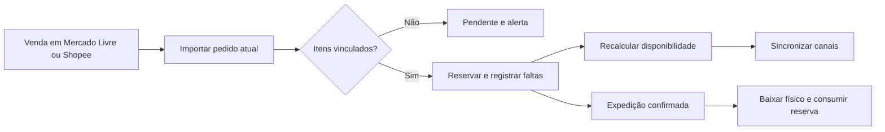

# PRD — Sistema de gerenciamento de estoque integrado a marketplaces

**Versão:** 0.2 — proposta consolidada com decisões do piloto  
**Data:** 23/10/2026  
**Canais iniciais:** Mercado Livre e Shopee, com foco inicial no Brasil  
**Documento complementar:** [architecture.md](architecture.md)

## 1. Visão do produto

Construir um sistema para uma empresa piloto que mantenha um estoque próprio central e sincronize vendas e disponibilidade entre Mercado Livre e Shopee. O painel também apresenta métricas de vendas e, quando os próprios marketplaces as disponibilizarem oficialmente à conta autorizada, métricas agregadas de público e interesse.

O produto deve responder de forma verificável: **o que temos, o que está reservado, quanto podemos vender, o que foi vendido em cada período e canal, quais métricas oficiais de público estão disponíveis e o que não foi sincronizado**.

A expansão para Amazon, Magalu, site próprio e loja física deverá ocorrer por novas integrações, preservando as regras centrais de estoque. Extensibilidade não implica implementar esses canais no MVP.

## 2. Contexto, premissas e decisões pendentes

Este documento consolida decisões de escopo informadas pelo usuário e mantém como propostas as escolhas técnicas ainda não validadas. O piloto é uma operação de uma empresa, com poucos usuários, um estoque próprio e conexão inicial ao Mercado Livre e à Shopee.

| Tema | Premissa proposta para o MVP | Validação necessária |
| --- | --- | --- |
| Operação | Uma empresa/loja piloto, poucos usuários e um estoque próprio compartilhado pelos canais | Papéis mínimos dos usuários e quantidade de contas por canal |
| Isolamento | Uma empresa no piloto; sem SaaS multiempresa ou cobrança na primeira entrega | Se e quando será necessário atender outras empresas |
| Mercadorias | Unidades inteiras, produtos simples e variantes | Produtos fracionados, lotes, validade ou números de série |
| Local de estoque | Um depósito próprio operacional | Depósitos adicionais e regras de atendimento |
| Anúncios | Não criar, editar ou administrar conteúdo de anúncios; identificar e vincular ofertas/variações existentes aos SKUs para estoque e métricas | Meios oficiais de descoberta e chaves de variação em cada canal |
| Pedidos | Iniciar o sistema com saldo cadastrado e sem importar vendas anteriores à conexão | Estados e eventos oficiais que representam a compra em cada canal |
| Reserva | Reservar assim que o marketplace sinalizar a compra no estado acordado; processar o evento rapidamente e de forma idempotente | Estado exato do pedido que deve disparar reserva e tratamento de pagamento/cancelamento por canal |
| Baixa física | Efetivar na expedição confirmada; pagamento sozinho não baixa físico | Processo operacional de separação e expedição |
| Reposição | Entrada manual auditada; devolução somente após conferência | Responsáveis e permissões |
| Disponibilidade | Um saldo compartilhado entre Mercado Livre e Shopee, com margem mínima de segurança | Valor inicial da margem e política operacional quando ocorrer overselling |
| Métricas | Mostrar vendas por período/canal; métricas de público e interesse somente se fornecidas oficialmente pelo marketplace | Inventário de endpoints, permissões, períodos e granularidade realmente disponíveis nas contas piloto |
| Infraestrutura | Sem provedor de hospedagem escolhido | Orçamento, operação local ou hospedada, recuperação e suporte |

O estoque inicial será cadastrado antes da ativação das escritas. Não haverá migração de vendas ou pedidos anteriores ao início do serviço; pedidos novos serão acompanhados desde a conexão. Os contratos e as métricas disponíveis precisam ser verificados por canal antes de prometer cobertura. Prazos, capacidade e metas deste documento são referências de planejamento, não compromissos comerciais.

## 3. Problema

O vendedor anuncia o mesmo produto em vários canais, mas administra alterações e vendas em locais diferentes. Atualizações manuais atrasam, códigos divergem e uma venda pode não reduzir a disponibilidade dos outros anúncios a tempo.

Consequências:

- Venda acima do saldo disponível e cancelamentos que prejudicam a operação.
- Divergências difíceis de explicar entre depósito, sistema e marketplace.
- Trabalho repetitivo para atualizar quantidades e conferir pedidos.
- Dependência de planilhas e da memória de pessoas específicas.
- Falhas de autorização ou sincronização descobertas somente após uma venda problemática.

O produto reduz esses riscos com controle central, histórico e convergência monitorada. Não pode garantir disponibilidade global instantânea entre plataformas independentes.

## 4. Objetivos

1. Centralizar cadastro de produtos, variantes, SKUs, saldo inicial e movimentações de estoque.
2. Relacionar cada unidade vendável interna às ofertas externas corretas.
3. Importar pedidos sem duplicar reservas ou baixas.
4. Atualizar a quantidade anunciada nos canais habilitados após alterações de disponibilidade.
5. Identificar eventos perdidos, falhas, divergências e contas que precisam de reautorização.
6. Permitir investigação e recuperação com ações auditadas.
7. Acompanhar unidades vendidas, ticket médio e produto mais vendido por período e marketplace.
8. Exibir métricas oficiais agregadas de público/interesse quando o canal conectado as disponibilizar para a conta autorizada.
9. Permitir que novos marketplaces e, futuramente, um canal próprio sejam integrados sem alterar as invariantes do estoque.

## 5. Não objetivos

- ERP completo, contabilidade, emissão fiscal, compras, financeiro e cálculo tributário.
- Gestão integral de logística, etiquetas, frete, mensagens, reclamações e pós-venda.
- Precificação automática, promoções e criação ou enriquecimento de anúncios no MVP.
- Gerenciar conteúdo, criar, editar ou otimizar anúncios no MVP; a leitura e o vínculo mínimo de ofertas existentes ainda são necessários para localizar o SKU afetado.
- Operar APIs de afiliados ou scraping no lugar das APIs oficiais de vendedor.
- Garantir ausência absoluta de overselling em canais com estoque compartilhado e integração assíncrona.
- Controlar como estoque próprio o inventário em centros de fulfillment dos marketplaces.
- Kits, composição de produtos, fabricação, lotes, validade e estoque fracionado no MVP.
- Desenvolver PDV, loja virtual ou conectores Amazon/Magalu nesta primeira entrega.
- Implantar microserviços ou infraestrutura complexa sem necessidade medida.
- Inferir idade, gênero, interesse ou perfil individual a partir de nome, endereço, documento ou comportamento de compra.
- Prometer dados de busca, impressões, visitas, demografia ou interesse que não estejam explicitamente disponíveis nas APIs/relatórios oficiais autorizados de cada marketplace.

## 6. Personas e usuários

| Usuário | Necessidade | Ações principais |
| --- | --- | --- |
| Dono/gestor | Ter confiança no saldo e reduzir cancelamentos | Conectar contas, habilitar canais, acompanhar divergências e aprovar políticas |
| Operador de estoque | Registrar movimentações e atender pedidos | Cadastrar SKUs, lançar entradas/ajustes, conferir reservas e expedição |
| Operador de integração/suporte | Recuperar falhas sem corromper estoque | Investigar eventos, corrigir vínculos, reprocessar e executar reconciliação |
| Consulta | Ver a operação sem poder alterá-la | Consultar saldos, pedidos e histórico |

Uma pessoa pode acumular papéis. Permissões são verificadas no backend e por organização. Segredos de integração não ficam disponíveis na interface.

## 7. Linguagem do domínio e regras essenciais

| Termo | Definição |
| --- | --- |
| Produto | Agrupamento comercial, como uma camiseta |
| Variante | Unidade vendável, como camiseta preta tamanho M; produto simples também possui uma variante |
| SKU | Código interno único da variante dentro da organização; não é o identificador do anúncio |
| Anúncio / listing | Oferta publicada em uma conta e canal |
| Variante externa | Modelo ou variação vendável dentro de um anúncio |
| Conta conectada | Loja/vendedor externo com autorização própria |
| Estoque físico | Unidades registradas como presentes no depósito próprio |
| Reserva | Unidades físicas comprometidas com um pedido ainda não expedido |
| Demanda descoberta | Quantidade de pedido conhecido que ainda não pôde ser reservada |
| Margem de segurança | Quantidade deliberadamente indisponível para novas vendas |
| Disponível para venda | Quantidade calculada para novos compromissos |
| Estoque observado | Última quantidade consultada no canal; não constitui saldo físico central |
| Reconciliação | Comparação periódica para recuperar mudanças e corrigir divergências |
| Métrica oficial do canal | Indicador ou relatório fornecido pelo marketplace para a conta autorizada, com definição, período, granularidade e origem registradas |
| Métrica derivada de pedidos | Indicador calculado apenas a partir de campos de pedidos oficialmente acessíveis, com fórmula e estados incluídos documentados |

Regras propostas:

1. Toda operação de estoque referencia uma variante e um depósito. SKU não é reutilizado para outro produto; renomeações, se permitidas, preservam o identificador e o histórico.
2. `Disponível = max(0, físico − reservado − margem de segurança − demanda descoberta)`. O cálculo considera o único estoque próprio compartilhado entre canais no piloto.
3. Uma venda não pode produzir duas baixas por ter chegado por webhook e consulta periódica.
4. Pagamento não altera novamente a reserva já efetuada. Na expedição, baixa física e consumo da reserva são uma única operação.
5. Cancelamento anterior à expedição libera apenas o que ainda estiver reservado. Cancelamento ou reembolso após expedição não devolve mercadoria automaticamente ao físico.
6. Falta de estoque vira exceção explícita: reserva-se o possível, registra-se a demanda descoberta e impede-se tratar o pedido como integralmente atendível. A prioridade de alocação deverá ser validada; não prometer atendimento automático.
7. O saldo remoto não sobrescreve o físico central. Uma divergência pode indicar venda ainda não importada e exige investigação antes de republicar quantidades maiores.
8. Oferta/variação não mapeada, integração incompatível ou conta sem autorização de escrita não recebe atualização automática; não é necessário administrar o conteúdo do anúncio.
9. Fulfillment externo deve ser identificado e separado. O MVP bloqueia sua gestão de escrita, sem misturar esse inventário ao depósito próprio.
10. Nenhum ajuste apaga movimentações anteriores; correções são operações compensatórias com justificativa.

Exemplo: físico 10, reservado 3, margem 1 e nenhuma falta produzem 6 disponíveis. Uma venda de 2 eleva a reserva a 5 e reduz o disponível a 4. Sua expedição leva físico a 8 e reserva a 3: o disponível continua 4. Não há segundo desconto da venda.

## 8. Requisitos funcionais

| ID | Requisito | Evidência de aceite |
| --- | --- | --- |
| RF-01 | Autenticar os poucos usuários do piloto e aplicar permissões no backend | Usuário sem permissão recebe recusa e não altera dados |
| RF-02 | Cadastrar produtos, variantes, SKUs e ativação | SKU repetido na mesma organização é rejeitado |
| RF-03 | Registrar saldo inicial, entradas, ajustes e saídas operacionais | Movimentação informa autor, quantidade, motivo e horário |
| RF-04 | Consultar físico, reservado, margem, demanda descoberta e disponível por SKU | Valores têm origem e histórico explicáveis |
| RF-05 | Conectar e desconectar contas Mercado Livre e Shopee por autorização oficial | Estado da conta e identidade externa ficam visíveis; senhas não são coletadas |
| RF-06 | Renovar credenciais e solicitar reautorização quando necessária | Credencial revogada interrompe chamadas e produz alerta |
| RF-07 | Importar anúncios e suas variantes de forma paginada e retomável | Reimportação não duplica ofertas |
| RF-08 | Vincular variante externa a variante interna e validar ambiguidades | Não publica estoque de vínculo ausente ou conflitante |
| RF-09 | Importar pedidos e alterações por notificações e consulta periódica | Repetir o mesmo pedido não repete efeito de estoque |
| RF-10 | Reservar, consumir reserva, liberar e tratar falta | Cancelamento e expedição duplicados mantêm saldos corretos |
| RF-11 | Publicar disponibilidade nos alvos de estoque compatíveis e habilitados | Mostra quantidade desejada, observada, estado e última confirmação |
| RF-12 | Reconciliar pedidos, vínculos e estoque remoto | Recupera pedido cuja notificação foi perdida |
| RF-13 | Exibir erros, divergências e operações pendentes | Identifica conta, recurso, causa e próxima ação |
| RF-14 | Retentar falhas transitórias e oferecer reprocessamento auditado | Falha definitiva não entra em ciclo infinito |
| RF-15 | Configurar margem de segurança e ativar/pausar sincronização por conta/alvo | Pausa impede novas escritas e informa se há chamada em andamento |
| RF-16 | Executar onboarding em modo de leitura antes de habilitar escrita | Prévia de impacto, baseline e escopo aprovado ficam registrados |
| RF-17 | Consultar trilha de alterações e exportar visão operacional simples | Histórico permite relacionar pedido, movimento e sincronização |
| RF-18 | Consultar unidades vendidas, ticket médio e produto mais vendido por período e marketplace | Resultado identifica período, canal, moeda, definição do pedido elegível e origem dos dados |
| RF-19 | Consultar métricas agregadas oficiais de público/interesse quando o canal as fornecer | Cada indicador mostra fonte, período, granularidade e indisponibilidade; nenhum atributo é inferido |
| RF-20 | Exibir cobertura e limitações das métricas por canal | Indicador ausente por falta de endpoint, permissão, dado ou cobertura aparece como indisponível, nunca como zero |

A confirmação de atualização depende do contrato do canal: aceitação da requisição e quantidade efetivamente observada são estados distintos. O sistema não apresenta somente um indicador genérico de sucesso.

## 9. Requisitos não funcionais

| ID | Requisito | Diretriz verificável |
| --- | --- | --- |
| RNF-01 | Consistência | Saldo, reserva, movimento e evento de saída gravados atomicamente no banco |
| RNF-02 | Durabilidade | Notificação reconhecida somente após gravação durável; recuperação após reinício |
| RNF-03 | Idempotência | Redelivery, retry e reprocessamento não duplicam efeitos locais |
| RNF-04 | Segurança | TLS, autorização por organização, tokens cifrados, logs sem credenciais |
| RNF-05 | Concorrência | Vendas simultâneas não reservam localmente as mesmas unidades |
| RNF-06 | Resiliência | Indisponibilidade de um canal não paralisa cadastro e estoque local |
| RNF-07 | Observabilidade | Rastrear pedido/evento até movimentação e tentativa de publicação |
| RNF-08 | Recuperação | Backup e restauração ensaiados; reconstrução de filas a partir do banco |
| RNF-09 | Manutenção | Regras de domínio independentes dos formatos externos, com contratos testáveis |
| RNF-10 | Usabilidade | Falhas e estados pendentes têm explicação e ação concreta |
| RNF-11 | Proteção de dados | Coletar somente dados de comprador necessários; definir retenção e acesso |
| RNF-12 | Capacidade | Limites, paginação, processamento em lote e concorrência configuráveis por canal |
| RNF-13 | Proveniência analítica | Métrica exibe marketplace, período, moeda, fórmula ou definição oficial e momento da última atualização |
| RNF-14 | Minimização de dados | Importar e reter somente dados pessoais necessários aos fluxos autorizados; métricas de público preferencialmente agregadas |

Volume inicial, número de contas e pico de eventos ainda não definidos. Levantar esses valores com a loja piloto antes de fechar metas de capacidade. A experiência local deve continuar utilizável quando uma API externa estiver lenta.

Metas técnicas iniciais: API interna p95 abaixo de 500 ms para consultas comuns no perfil acordado; confirmação de webhook abaixo do prazo de cada provedor; disponibilidade mensal do serviço de 99,5%; RPO de até 15 minutos e RTO de até 4 horas. São metas propostas a validar com infraestrutura, orçamento e ensaio de recuperação, não resultados já obtidos.

## 10. Escopo do MVP e fases

### Fase 0 — Descoberta e viabilidade

- Confirmar acesso oficial às APIs de vendedor e às métricas/relatórios de cada conta piloto, escopos, permissões, retenção e limites.
- Inventariar SKUs, ofertas/variantes existentes, modelos logísticos e estados de pedidos; ofertas não serão criadas nem editadas pelo sistema.
- Validar qual estado/evento de compra dispara reserva, além das transições de baixa, cancelamento, divergência e margem em cada canal.
- Cadastrar e conferir o saldo inicial antes de habilitar sincronização; não importar vendas anteriores ao início do serviço.
- Confirmar quais métricas podem ser derivadas dos pedidos oficiais e quais existem apenas em relatório oficial do canal; não presumir dados demográficos ou de busca.
- Prototipar telas essenciais e validar com operadores.

**Saída:** acesso demonstrado, políticas aprovadas e specs pequenas com critérios observáveis. Sem essas dependências, não considerar o conector pronto.

### Fase 1 — MVP operacional

- Poucos usuários para uma empresa/loja piloto e um depósito próprio.
- Cadastro de produto/variante/SKU, saldo inicial, entradas e ajustes auditados.
- Contas Mercado Livre e Shopee, começando por um conector e repetindo o mesmo contrato no segundo.
- Leitura mínima das ofertas existentes para vincular variantes aos SKUs, sem criar ou administrar anúncios; importação de pedidos, reservas e baixa por expedição.
- Sincronização de disponibilidade, reconciliação, retries e tratamento de falhas permanentes.
- Painel de pendências, divergências, autorização e histórico.
- Painel analítico com unidades vendidas, ticket médio e produto mais vendido por período e canal, usando dados acessíveis oficialmente.
- Métricas agregadas de público/interesse somente quando fornecidas oficialmente para aquela conta; canais sem esses dados mostram cobertura/indisponibilidade explícita.
- Habilitação gradual de escrita por conjunto de anúncios após validação.

**Saída:** estoque sincronizado com vendas de ambos os canais, visões de vendas por período e os indicadores oficiais disponíveis, com cobertura documentada. Um conector bloqueado por aprovação externa constitui entrega parcial, não MVP completo. O MVP não promete idade ou tendências gerais de busca sem métrica oficial acessível.

### Fases futuras

| Fase | Possibilidades | Condição de entrada |
| --- | --- | --- |
| 2 — Operação ampliada | Múltiplos depósitos, transferências, inventário, devoluções, cotas por canal e análises adicionais que se tornem disponíveis | Dados e risco operacional do MVP medidos |
| 3 — Catálogo e comércio | Publicação de anúncios, preços, promoções e kits | Novas regras de domínio e permissões especificadas |
| 4 — Novos canais | Amazon, Magalu, site próprio e integração com PDV | Conector e política de cada canal homologados |
| 5 — Escala de produto | Múltiplas empresas, cobrança, administração e SLA comercial | Necessidade comercial e isolamento validados |

A ordem futura não representa compromisso de prazo. Um canal próprio poderá ser integrado como nova origem de venda, sob controle do mesmo serviço transacional; isso ainda exigirá regras próprias de checkout. Loja física e operação offline precisam de política própria antes de serem prometidas.

## 11. Fluxos principais

### 11.1 Conectar conta e iniciar operação

1. Gestor inicia autorização na plataforma e retorna ao sistema.
2. Backend valida a tentativa, identifica a conta e armazena credenciais com proteção.
3. Lê ofertas/variações existentes para fazer os vínculos necessários; não importa pedidos históricos anteriores ao início do serviço.
4. Operador resolve vínculos; gestor confere o saldo inicial cadastrado antes de ativar a sincronização. O piloto começa sem importar vendas anteriores.
5. Sistema exibe prévia de alterações por anúncio e incompatibilidades.
6. Gestor habilita escrita para escopo definido; sincronização inicial é acompanhada até confirmação.

Falhas: acesso negado, conta errada, callback inválido, loja já vinculada, permissões insuficientes, estoque remoto incompatível ou SKU ambíguo mantêm escrita bloqueada.

### 11.2 Entrada ou ajuste de estoque

1. Operador informa SKU, quantidade e justificativa.
2. Sistema valida permissão e versão do saldo, registra movimentação e recalcula disponibilidade.
3. Atualizações externas entram em processamento assíncrono.
4. Interface apresenta pendente, confirmado, divergente ou erro por destino.

Contagem física inferior às reservas abre incidente e exige reclassificar reservas afetadas como demanda descoberta, mantendo indisponibilidade conservadora; não ocultar a diferença por rejeitar indefinidamente a realidade física.

### 11.3 Venda em um canal

1. Evento ou consulta identifica pedido novo/alterado.
2. Sistema consulta o estado atual, resolve itens e aplica a transição idempotente.
3. Reserva unidades; eventuais faltas ficam explícitas.
4. Recalcula e propaga disponibilidade para todos os alvos relacionados, inclusive o canal de origem quando necessário.
5. Expedição confirmada consome reserva e baixa físico uma única vez.

### 11.4 Cancelamento e devolução

Cancelamento confirmado antes da expedição libera a parcela não consumida da reserva e encerra a demanda descoberta correspondente. Cancelamento parcial atua sobre os itens e quantidades corretos. Após expedição, registra-se o novo estado sem repor físico; devolução física requer recebimento e conferência, com entrada auditada. Evento antigo não desfaz uma expedição mais recente.

### 11.5 Divergência e recuperação

Reconciliação identifica diferença, atualiza pedidos primeiro e compara novamente. Escritas que aumentariam estoque ficam suspensas quando a visão de pedidos estiver desatualizada ou houver resultado remoto incerto. Casos compatíveis convergem automaticamente; casos de vínculo, falta ou autorização exigem ação explicada. Corrigir e reprocessar não duplica efeitos já registrados.

## 12. Critérios de sucesso e aceite

### Métricas de produto no MVP

| Métrica | Definição proposta | Agrupamentos / limites |
| --- | --- | --- |
| Unidades vendidas | Soma das quantidades de itens em pedidos que o canal classifica como elegíveis para venda no intervalo | Por produto/SKU, marketplace e período; cancelamentos, devoluções e reembolsos seguem estados e dados disponíveis no canal |
| Ticket médio | Valor total dos pedidos elegíveis dividido pelo número desses pedidos no mesmo intervalo | Por marketplace e período; exibir moeda e não misturar moedas |
| Produto mais vendido | Produto/SKU com maior quantidade de unidades elegíveis no intervalo | Por marketplace e visão consolidada; desempate e ausência de vendas devem ser explícitos |
| Público/interesse | Apenas indicadores agregados que o marketplace exponha oficialmente à conta conectada | Exibir o nome/definição do canal, período, cobertura e atualização; sem inferência individual |

Os valores calculados a partir de pedidos são permitidos somente quando a API oficial entrega os campos necessários. Indicadores existentes apenas nos relatórios oficiais podem ser importados pelo provider se houver permissão e mecanismo suportado. Resultados de canais distintos não são somados quando definição, moeda, granularidade ou cobertura não forem comparáveis. Um dado indisponível não equivale a zero.

### Metas de produto propostas para o piloto

| Indicador | Meta inicial | Forma de medir |
| --- | --- | --- |
| Cobertura do estoque integrado | 100% dos anúncios no escopo aprovado com vínculo válido ou exclusão explícita | Relatório de onboarding |
| Convergência após alteração local | 95% em até 60 s e 99% em até 5 min, com APIs saudáveis e cotas disponíveis | Tempo entre commit e verificação remota; informar denominador e exclusões |
| Recuperação de pedido sem webhook | Em até 15 min no perfil piloto e API disponível | Teste controlado de perda de notificação |
| Divergência silenciosa | Nenhuma divergência conhecida sem estado, responsável ou próxima ação | Painel diário |
| Efeitos duplicados | Zero em testes de duplicação, retry, replay e reinício | Testes automatizados e auditoria do piloto |
| Esforço manual | Reduzir ao menos 50% do tempo de atualização de estoque | Comparação antes/depois com a mesma operação |
| Overselling | Medir taxa e causas; zero causado por dupla reserva local | Relacionar incidentes, pedidos e atraso de integração |
| Cobertura analítica | 100% das métricas exibidas identificam origem, período, atualização e definição | Revisão do painel e dos dados importados |

O acompanhamento deve mostrar também os períodos excluídos por indisponibilidade, limites e contas inválidas. A meta de convergência não substitui detecção de indisponibilidade.

### Cenários obrigatórios de aceite

- Duas vendas simultâneas da última unidade: somente uma reserva local é alocada; a outra gera falta explícita e disponibilidade zero.
- Mesmo evento recebido dez vezes e pedido recuperado por polling: um único efeito de reserva/baixa.
- Eventos fora de ordem: cancelamento ou expedição confirmados não são revertidos por snapshot antigo.
- Expedição repetida, cancelamento parcial e cancelamento após expedição preservam saldos e histórico.
- Pedido com variante desconhecida não é ignorado: vira pendência rastreável e bloqueia escrita insegura no escopo afetado.
- Token expirado é renovado sem concorrência destrutiva; revogação exige reautorização.
- Falha de rede após envio de estoque não gera repetição cega de comando antigo.
- Reinício entre commit e enfileiramento recupera a publicação pendente.
- Perda do Redis não perde o livro de estoque nem impede reconstrução de trabalho pendente.
- Conta ou anúncio incompatível não recebe escrita; teste inclui estoque gerenciado externamente.
- Restauração de backup é ensaiada em ambiente isolado, sem publicar dados antigos nos canais.
- Usuários sem a permissão adequada não leem nem alteram dados, credenciais ou tarefas da operação piloto.
- Relatórios de vendas para o mesmo intervalo seguem as fórmulas e estados elegíveis documentados e preservam separação por canal/moeda.
- Métrica de público não disponível ou sem permissão aparece como indisponível, não como zero nem como estimativa.
- A integração não coleta idade ou interesses de compradores individualmente; só apresenta agregados oficialmente fornecidos pelo canal.
- Oferta sem vínculo com SKU não entra em análise por produto até que o vínculo seja resolvido.

## 13. Riscos e mitigação

| Risco | Impacto | Mitigação / condição |
| --- | --- | --- |
| Aprovação ou permissão de API indisponível | Bloqueia conector | Validar acesso antes de prometer escopo ou prazo |
| Vendas simultâneas em canais independentes | Overselling | Margem, atualização rápida, detecção de atraso e opção futura de cotas exclusivas |
| Reposição remota antes de importar venda | Reabre unidades já vendidas | Atualizar pedidos antes de aumentar estoque, bloquear aumentos em estado incerto |
| SKU/variante vinculado incorretamente | Atualiza produto errado | Prévia, validação e auditoria de vínculos; sem associação automática ambígua |
| Evento perdido ou duplicado | Saldo divergente | Inbox durável, idempotência e reconciliação |
| Tokens revogados ou vazados | Interrupção ou acesso indevido | Cifragem, menor privilégio, rotação, alertas e reautorização |
| Modelo de estoque do marketplace diferente | Quantidade ineficaz ou incorreta | Capabilities por conta, oferta/variação e localização |
| Mudanças de API ou quotas | Atrasos e falhas | Contratos de integração, limites configuráveis e monitoramento |
| Saldo inicial e pedidos históricos mal classificados | Dupla baixa ou reposição indevida | Corte operacional e reconciliação assistida |
| Métricas de público não expostas ou diferentes entre canais | Expectativa analítica não atendida ou comparação enganosa | Verificar capacidades reais na Fase 0; mostrar cobertura e não inferir nem comparar métricas incompatíveis |
| Operador altera saldo diretamente no canal | Conflito com fonte central | Política explícita, detectar divergência e investigar antes de aumentar |
| Restore ou replay publica saldo antigo | Exposição indevida de estoque | Escrita pausada após recuperação e nova reconciliação obrigatória |

## 14. Dependências

- Aplicações de desenvolvedor, credenciais, aprovação e contas de vendedor elegíveis nos dois marketplaces.
- Documentação aplicável ao Brasil, permissões reais, tópicos disponíveis, limites e modelos logísticos das contas piloto.
- Endpoint HTTPS acessível pelos provedores para callbacks e webhooks; desenvolvimento local requer exposição controlada ou consulta periódica permitida.
- Base de SKUs confiável, contagem inicial e responsável por validar a migração.
- Política aprovada de reserva/expedição, janela de pagamento e divergência.
- Mapa por canal dos campos de pedido e métricas oficiais acessíveis, permissões, períodos de retenção, granularidade e definições.
- Banco, processamento assíncrono, gestão de segredos e infraestrutura de backup com responsáveis definidos.
- Definição de volume, retenção de dados e horário de suporte antes de assumir SLA.

## 15. Backlog inicial orientado a specs

Ordem sugerida por dependências; sem estimativas ou prioridades comerciais inventadas. Cada item deve virar uma spec com erro, escopo e aceite antes de implementação.

| Spec proposta | Entrega verificável | Depende de |
| --- | --- | --- |
| SPEC-001 — Viabilidade e políticas | Demonstrar acesso, inventário de capacidades e mapa de estados dos canais | Contas piloto |
| SPEC-002 — Organização e acesso | Usuários, papéis e isolamento testado | SPEC-001 |
| SPEC-003 — Catálogo interno | Produto, variante e SKU com unicidade | SPEC-002 |
| SPEC-004 — Livro de estoque | Entradas, ajustes, saldo, reservas e invariantes transacionais | SPEC-003 e políticas |
| SPEC-005 — Processamento confiável | Inbox, outbox, jobs recuperáveis e replay idempotente | SPEC-002 |
| SPEC-006 — Mercado Livre: autorização e leitura | Conectar, renovar, importar anúncios/pedidos sem escrita | SPEC-001, SPEC-003, SPEC-005 |
| SPEC-007 — Vínculos e baseline | Mapear ofertas/variantes e conferir o saldo inicial antes da ativação, sem migração de vendas anteriores | SPEC-004, SPEC-006 |
| SPEC-008 — Pedidos e reservas | Transições, falta, expedição e cancelamentos homologados | SPEC-004, SPEC-007 |
| SPEC-009 — Mercado Livre: estoque | Publicação por alvo compatível e verificação remota | SPEC-008 |
| SPEC-010 — Shopee | Autorização, assinatura, leitura, estados e estoque no mesmo contrato | SPEC-005 a SPEC-009 e acesso Shopee |
| SPEC-011 — Reconciliação e recuperação | Polling com checkpoint, erros, dead-letter e reprocessamento | SPEC-009, SPEC-010 |
| SPEC-012 — Analytics de vendas | Relatórios de unidades, ticket médio e ranking por período/canal, com fórmulas e proveniência | SPEC-008, SPEC-010 e campos oficiais de pedidos |
| SPEC-013 — Métricas de público disponíveis | Inventariar/importar métricas agregadas de público/interesse oferecidas oficialmente; expor indisponibilidade por canal | SPEC-001 e permissões/recursos confirmados |
| SPEC-014 — Operação e segurança | Painel de pendências, trilha, alertas, backup/restore e validação de isolamento | Specs anteriores |
| SPEC-015 — Piloto e aceite | Cenários deste PRD, métricas e ativação gradual dos dois canais | SPEC-014 |

Observabilidade, segurança e testes começam em cada spec; SPEC-012 consolida a operação. A numeração acima é local a esta proposta e deve ser ajustada ao repositório futuro.

## 16. Referências e próximos documentos

Fontes oficiais consultadas em 23/10/2026. Contratos, disponibilidade por conta e permissões deverão ser reconfirmados no início de cada conector.

- [Mercado Livre — Autenticação e autorização](https://developers.mercadolivre.com.br/pt_br/autenticacao-e-autorizacao): autorização do vendedor e credenciais de acesso.
- [Mercado Livre — Gestão de estoque multiorigem / User Products](https://developers.mercadolivre.com.br/pt_br/api-docs-pt-br/gestao-de-estoque-multiorigem-user-products): diferenças entre estoque próprio, localização e fulfillment.
- [Mercado Livre — Notificações](https://developers.mercadolivre.com.br/pt_br/produto-receba-notificacoes): entrega de eventos e consulta de recursos.
- [Mercado Livre — Permissões funcionais](https://developers.mercadolivre.com.br/pt_br/permissoes-funcionais/): inclui escopos de métricas de negócio, sem garantir que todo indicador ou dado demográfico esteja disponível para toda conta.
- [Mercado Livre — Pedidos e opiniões](https://developers.mercadolivre.com.br/pt_br/pedidos-e-opinioes): dados de pedidos e itens para métricas calculáveis quando os campos necessários forem autorizados.
- [Mercado Livre — Guia de integração in-house](https://developers.mercadolivre.com.br/desenvolvimento-in-house): recomenda selecionar somente permissões necessárias e documenta recursos de venda e métricas.
- [Brasil — Lei Geral de Proteção de Dados, art. 6º](https://www.planalto.gov.br/ccivil_03/_ato2015-2018/2018/lei/l13709compilado.htm): finalidade, adequação, necessidade e demais princípios para tratamento de dados pessoais.
- [Shopee Open Platform — API calls](https://open.shopee.com/developer-guide/16): chamadas assinadas e identificação da loja.
- [Shopee Open Platform — Authorization and Authentication](https://open.shopee.com/developer-guide/20): autorização e renovação de credenciais.

O próximo ciclo deverá homologar políticas de pedidos, métricas e permissões nas contas piloto, consolidar domínio e EDD, prototipar o painel e então detalhar specs. [architecture.md](architecture.md) apresenta a proposta de engenharia correspondente; decisões difíceis de reverter devem ganhar ADR quando aprovadas.
